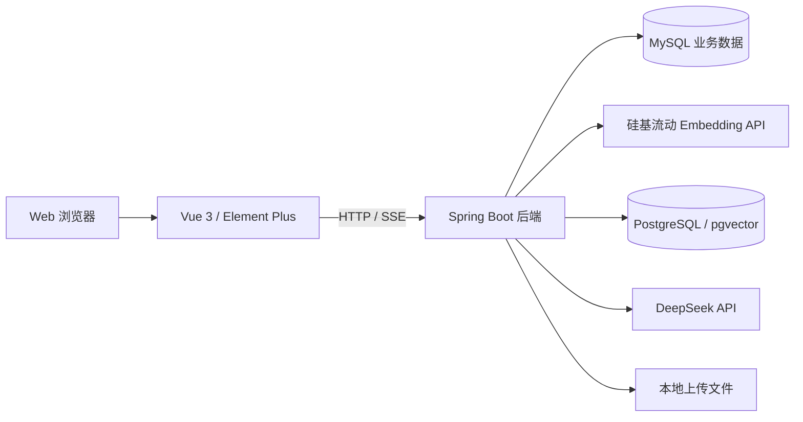

# 心屿 · 青少年心理健康知识服务平台

面向 Web 浏览器的心理健康知识服务应用，提供 AI 问答、心理自评、科普阅读和后台管理。项目采用 Vue 3、Spring Boot 和检索增强生成（RAG）：业务数据保存在 MySQL，知识向量保存在 PostgreSQL 的 pgvector 扩展中，后端调用 DeepSeek 生成回答。

代码仓库：[hahahachaoge/xinyu](https://github.com/hahahachaoge/xinyu)，已设为 **Public**，评委无需 GitHub 登录即可查看代码、README 和提交历史。具体见 [代码仓库交付检查](docs/repository-checklist.md)。

## 主要功能

- 智能问答：知识检索、DeepSeek 流式回答、多轮会话、聊天历史和满意度反馈。聊天页面不显示片段编号及来源标签。
- 心理自评：量表浏览、答题、服务端计分和个人测评记录。
- 科普阅读：文章分类、阅读和收藏。
- 后台管理：用户、知识文档与分块、向量索引、量表与评分规则、文章和统计。
- 权限控制：登录验证、管理员授权和个人记录归属校验。

AI 回答和测评结果用于知识参考和自我了解，不替代专业诊断与治疗。

## 技术架构



用户问题由后端生成向量并检索知识分块，再结合会话历史调用 DeepSeek，通过 SSE 返回文本。检索不可用或未命中时，现有实现可尝试关键词检索；没有相关资料时会在模型提示中说明。MySQL 保存文档、分块和聊天等业务记录，pgvector 保存对应的 1024 维向量。浏览器不直接接触数据库密码或模型 API Key。

| 层次 | 技术 | 主要位置 |
| --- | --- | --- |
| 前端 | Vue 3.5、Vite 5、Element Plus、Pinia、Vue Router、Axios | 前端 `src` |
| 后端 | Java 17、Spring Boot 3.3.1、MyBatis-Plus | 后端 `src/main/java/com/example/web` |
| AI 与检索 | DeepSeek、LangChain4j 0.34.0、硅基流动嵌入服务 | 后端 `service`、`config` |
| 数据存储 | MySQL 8、PostgreSQL + pgvector、本地文件 | 初始化 SQL、`external-resources` |
| 生产入口 | Nginx，同站 `/api` 代理 | `deploy/nginx.conf` |

## 项目目录

```text
QaMentalHealthKnowledgeServicesAdolescents.elementui/
  src/views/                 用户端及后台页面
  src/components/            公共组件
  src/utils/                 请求与通用工具
  package.json               前端依赖及脚本
  package-lock.json          前端依赖锁定文件
QaMentalHealthKnowledgeServicesAdolescents.springboot/
  src/main/java/com/example/web/
    controller/              HTTP 接口
    service/                 业务服务与 AI / 向量检索
    mapper/                  MyBatis 数据访问
    entity/                  数据实体
    dto/                     请求和响应对象
    config/                  框架、AI 及演示模式配置
    interceptor/             请求权限拦截
    utils/                   公共工具
  src/main/resources/        YAML 配置、Mapper XML
  src/test/                  后端测试
  external-resources/        演示素材及运行时上传目录
  pom.xml                    后端依赖清单
docs/                        环境、评审、部署等说明
deploy/                      生产启动脚本与 Nginx 模板
scripts/                     发布打包脚本
qa_mental_health_knowledge_services_adolescents.sql   新库初始化文件
.env.example                 无真实密钥的配置模板
```

## 环境准备

| 工具 / 服务 | 要求 |
| --- | --- |
| Git | 克隆和保留提交历史 |
| Node.js / npm | Node.js 18+；建议使用 Node.js 22 LTS，npm 随 Node 安装 |
| Java / Maven | JDK 17 或兼容版本、Maven 3.9.x |
| MySQL | 8.x，默认端口 `3306` |
| PostgreSQL | 建议 16，已安装匹配版本的 pgvector 扩展，默认端口 `5432` |
| 模型服务 | 有效的 DeepSeek Key、硅基流动 Embedding Key，账号具备对应模型访问权限和可用额度 |

完整变量说明、依赖清单及常见错误见 [环境配置说明](docs/environment.md)。以下本地命令全部使用 **Windows CMD**。

## 安装与运行

### 1. 克隆仓库并配置本地环境

在放置项目的目录执行，公开仓库无需额外评审授权：

```cmd
git clone https://github.com/hahahachaoge/xinyu.git
cd xinyu
if not exist .env.properties copy .env.example .env.properties
notepad .env.properties
```

填写 `MYSQL_USERNAME`、`MYSQL_PASSWORD`、`PGVECTOR_USER`、`PGVECTOR_PASSWORD`、`JWT_SECRET`、`DEEPSEEK_API_KEY` 和 `EMBEDDING_API_KEY`。`JWT_SECRET` 使用自己生成的随机长字符串。模板不包含可用的私人密码或 Key；评审者需配置自己的服务凭据。

`.env.properties` 已被 Git 忽略。后端从工作目录及其上一级加载该文件，也支持同名系统环境变量；请按下文进入后端目录启动。不要将密钥填写到前端或任何 `VITE_` 变量中。

### 2. 初始化新的演示数据库

**只在新建的开发 / 评审数据库执行。MySQL SQL 包含重建表操作，已有数据不要重复导入。** 此步骤不适用于更新现有项目数据。

在项目根目录执行，命令会提示输入数据库密码：

```cmd
mysql -u root -p -e "CREATE DATABASE IF NOT EXISTS qa_mental_health_knowledge_services_adolescents CHARACTER SET utf8mb4;"
mysql -u root -p --default-character-set=utf8mb4 qa_mental_health_knowledge_services_adolescents < qa_mental_health_knowledge_services_adolescents.sql
psql -U postgres -h localhost -d postgres -c "CREATE DATABASE qa_mental_health_knowledge_services_adolescents;"
psql -U postgres -h localhost -d qa_mental_health_knowledge_services_adolescents -c "CREATE EXTENSION IF NOT EXISTS vector;"
```

若 PostgreSQL 数据库已经存在，跳过创建数据库的命令。pgvector 必须先安装到 PostgreSQL 中；`CREATE EXTENSION` 只是启用扩展，不会下载安装它。默认两个数据库的名称均为 `qa_mental_health_knowledge_services_adolescents`。

### 3. 下载依赖

在项目根目录执行，首次运行需要联网：

```cmd
cd QaMentalHealthKnowledgeServicesAdolescents.springboot
mvn.cmd dependency:go-offline "-Dmaven.repo.local=.maven-repository"
cd ..\QaMentalHealthKnowledgeServicesAdolescents.elementui
npm.cmd ci --cache .npm-cache
cd ..
```

Maven 启动或构建时也会自动补充所需依赖。使用 `npm ci` 按锁定文件安装，不需要把本机的依赖文件夹上传到仓库。

### 4. 启动后端（CMD 窗口一）

从项目根目录执行，评委首次运行使用演示模式：

```cmd
cd QaMentalHealthKnowledgeServicesAdolescents.springboot
mvn.cmd spring-boot:run "-Dmaven.repo.local=.maven-repository" "-Dspring-boot.run.profiles=demo"
```

| 登录账号 | 登录密码 | 登录角色 |
| --- | --- | --- |
| `user` | `12345678` | 用户 |
| `admin` | `12345678` | 管理员 |

这是所有者指定公开的固定测试账号。演示模式会维护账号、密码和角色；正常重启保留账号 ID 与关联数据，不清空数据库。真实数据库密码、JWT 密钥和模型 Key 需另外配置。更多细节见 [评委运行说明](docs/judging-demo.md)。

普通开发模式可省略 `"-Dspring-boot.run.profiles=demo"`，该模式不自动创建演示账号。生产模式与演示账号的处理见 [部署说明](docs/deployment-step-3.md)。

### 5. 启动前端（CMD 窗口二）

另开一个 CMD，从项目根目录执行：

```cmd
cd QaMentalHealthKnowledgeServicesAdolescents.elementui
npm.cmd run dev
```

- 前端页面：<http://localhost:8000>
- 后端接口：<http://localhost:7406>

保持两个窗口以及 MySQL、PostgreSQL 服务运行。关闭应用时在相应窗口按 `Ctrl+C`；正常停止、启动不会重新导入数据库。

### 6. 首次建立知识向量并验收

全新导入的 MySQL 示例数据不包含 PostgreSQL 向量。配置有效的嵌入服务 Key 后，以 `admin` 登录，在知识文档管理中执行“重建全部分块向量”，等待结束后刷新索引检查，确认分块和真实向量匹配。已有正常索引的环境无需重复执行。

再以 `user` 登录，验证科普阅读、心理测评和 AI 提问；刷新页面确认聊天记录保留。聊天页面不显示片段及来源标签，检索数据仍由后端使用。详细测试步骤见 [评委运行说明](docs/judging-demo.md)。

## 构建与测试

在前端目录执行生产构建：

```cmd
npm.cmd run build
```

在后端目录执行测试或打包：

```cmd
mvn.cmd test "-Dmaven.repo.local=.maven-repository"
mvn.cmd package "-Dmaven.repo.local=.maven-repository"
```

前端输出 `dist/`，后端输出 `target/web-0.0.1-SNAPSHOT.jar`。从项目根目录执行 `scripts\package-production.cmd` 可整理已有构建产物。公网服务器部署尚未完成；生产配置、Nginx 模板及打包方法见 [部署说明](docs/deployment-step-3.md)。

## 团队信息

团队成员来自华南师范大学，围绕系统架构与后端开发、内容素材与视觉创作、前端设计与测试部署分工协作，共同推进项目开发与交付。

| 项目 | 内容 |
| --- | --- |
| 学校 / 单位 | 华南师范大学 |
| 团队名称 | 不知名队伍 |
| 队长 | 黄彪骐 |
| 指导教师 | 待填写 |
| 队员 | 蓝俊豪、林佳逸 |
| 联系方式 | 待填写 |

### 成员分工

| 成员 | 团队角色 | 主要职责 |
| --- | --- | --- |
| 黄彪骐 | 队长 · 系统架构与后端开发 | 负责项目整体技术架构与模块划分，设计并实现后端业务逻辑，协调系统各模块的衔接与集成。 |
| 蓝俊豪 | 队员 · 内容素材与视觉创作 | 负责项目相关素材的收集、筛选与整理，以及配套图片的创作，为页面展示和内容呈现提供视觉素材支持。 |
| 林佳逸 | 队员 · 前端设计与测试部署 | 负责前端页面布局与交互设计，开展功能测试和页面效果验证，并承担上线部署相关工作。 |

以上为团队职责分配，不代表公网部署已完成；实际部署状态以项目部署说明和验收结果为准。指导教师及联系方式尚未提供，暂保留“待填写”。

## 代码规范与 Git 历史

前端沿用组件、页面与公共请求工具的组织方式；后端采用 Controller、Service、Mapper、Entity / DTO 分层。关键配置、权限和 RAG 流程已有注释，新增代码遵循 [协作与代码规范](docs/code-conventions.md)。

保留仓库已有真实提交，不改写、合并或伪造历史。后续提交采用 `fix(scope): ...`、`feat(scope): ...`、`docs(scope): ...` 等格式。查看完整记录：

```cmd
git log --oneline --graph --all
```

评审时请使用 `git clone` 获取仓库；下载 ZIP 不包含 `.git` 提交历史。

## 文档导航

- [环境配置与依赖清单](docs/environment.md)
- [评委账号与验收方法](docs/judging-demo.md)
- [代码仓库交付检查](docs/repository-checklist.md)
- [协作与代码规范](docs/code-conventions.md)
- [生产部署与打包](docs/deployment-step-3.md)
- [知识资料维护说明](docs/knowledge-provenance.md)

本地密钥、数据库备份、依赖缓存、日志和构建产物不纳入版本管理。`external-resources` 中已有演示素材随仓库提供；新增上传文件和私人业务数据不会自动成为交付内容。
