# 心屿青少年心理健康知识服务平台技术方案

文档版本：2026-11-16 整合版。正式排版及提交页码以同目录 PDF 为准。

学校：华南师范大学；队伍：不知名队伍-；队长：黄彪骐；队员：蓝俊豪、林佳逸；指导教师：刘寿强。

在线网站：https://xinyu-care.xyz/#/front/home

公开源码：https://github.com/hahahachaoge/xinyu

## 摘要

心屿是一款面向青少年心理健康知识需求的 Web 应用，提供智能问答、科普阅读、心理自评和个人记录管理等功能。平台围绕学习压力、情绪调节、人际沟通等日常话题，为用户提供便于访问、理解和持续使用的知识服务。

项目采用前后端分离架构，前端使用 Vue 3 构建页面与交互，后端使用 Spring Boot 实现业务处理和模型接入。智能问答采用检索增强生成技术：系统先从知识库中检索相关资料，再结合最近的会话内容和用户问题调用 DeepSeek 生成回答，通过流式传输逐步展示结果。MySQL 保存用户、会话、测评及知识分块等业务数据，PostgreSQL 的 pgvector 扩展保存文本向量。

平台在功能实现的同时，关注数据保存、权限控制和异常处理。聊天记录在回答完整生成后统一保存；个人记录根据用户身份校验访问权限；心理自评由服务端验证答案并计算结果。现有自动化测试共 70 项，覆盖账号、权限、计分、模型接口、文件处理和流式解析等内容，全部通过。

本项目以心理健康知识学习和自我了解为主要用途，模型回答与测评结果不替代专业诊断与治疗。

关键词

青少年心理健康；Web 应用；检索增强生成；DeepSeek；流式交互；心理自评

| 术语 | 含义 |
| --- | --- |
| RAG | 检索增强生成：先检索相关资料，再结合资料组织模型回答。 |
| Embedding | 文本嵌入：将文本转换为用于比较语义相关性的向量。 |
| SSE | 服务器发送事件：持续向浏览器推送数据，逐步展示回答。 |
| JWT | 用于传递登录身份的签名凭据。 |
| pgvector | PostgreSQL 的向量存储与检索扩展。 |

## 一、项目概述与需求分析

### 1.1 项目背景与建设目标

青少年在学习和生活中会遇到压力调节、情绪管理及人际沟通等问题，对心理健康知识有着实际需求。网页平台能够将知识查询、内容阅读和自我了解等功能集中呈现，使用户通过浏览器即可使用相关服务。

心屿以日常使用场景为出发点，将智能问答、科普阅读与心理自评整合到同一平台。用户既可以直接提出问题，也可以按主题阅读文章，或自主选择量表完成测评，并在个人记录中查看已保存的内容。

项目主要目标包括：建立清楚的页面导航和功能入口；将知识检索与大模型问答结合；保存会话、收藏和测评记录；提供后台内容维护功能；在服务端落实权限校验、结果计算和异常处理。

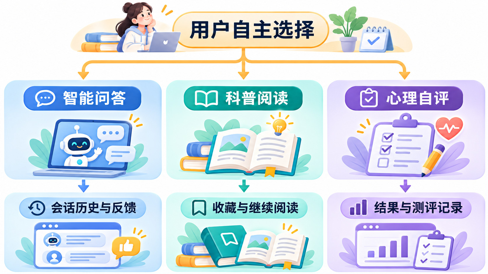

图 1-1  用户功能使用流程

### 1.2 典型使用场景

用户进入首页后，可以通过顶部导航选择智能问答、科普专区或心理测评。在智能问答中，用户输入问题后阅读逐段生成的回答，并联系前文继续追问；在科普专区中，用户按主题浏览和收藏文章；在心理自评中，用户完成量表作答，查看结果及历史记录。管理员通过后台维护用户、文章、知识文档、量表及评分规则。

### 1.3 用户角色与使用需求

| 用户角色 | 主要需求 | 对应功能 |
| --- | --- | --- |
| 游客 | 了解平台内容，浏览公开信息。 | 首页、公开文章、公告、登录与注册入口。 |
| 普通用户 | 提出问题、学习知识、进行自评并查看个人记录。 | 智能问答、文章收藏、心理自评、会话与测评记录。 |
| 管理员 | 维护平台内容和业务配置。 | 用户与内容管理、量表配置、评分规则及知识索引维护。 |

### 1.4 核心功能需求

| 功能模块 | 主要要求 |
| --- | --- |
| 智能问答 | 支持问题提交、知识检索、流式回答和多轮交流。 |
| 会话管理 | 支持新建会话、查看历史和恢复已保存的对话。 |
| 科普阅读 | 支持文章分类、内容阅读和个人收藏。 |
| 心理自评 | 支持量表选择、在线作答、服务端计分和结果查询。 |
| 知识管理 | 支持文档解析、分块处理、向量生成、索引检查和重建。 |
| 权限控制 | 区分公开、个人和管理操作，校验个人记录归属。 |
| 后台维护 | 支持用户、内容、知识与量表配置的日常管理。 |

### 1.5 非功能需求

平台面向 PC Web 使用场景，页面布局和交互围绕桌面浏览器设计。各模块采用统一导航、表单样式和反馈方式，帮助用户理解当前操作状态。

系统通过流式输出及时展示生成内容，并对网络中断、模型服务错误和保存失败等情况提供提示。敏感配置保存在服务端，个人数据访问由后端校验。代码按模块组织，配套提供依赖清单、配置模板、运行说明和测试用例，便于安装、维护与复现。

## 二、Web 页面与交互设计

### 2.1 首页设计

首页承担平台介绍和功能导航的作用。顶部导航集中展示首页、智能问答、科普专区和心理测评等入口，用户可以直接选择所需功能。页面以统一的平台标识、柔和的蓝紫色和主题插画，配合简洁文字，传达心理健康知识服务定位。主题卡片围绕学习压力、情绪调节等日常话题组织内容，帮助用户从熟悉的问题开始使用。


图 2-1  平台首页

| 页面设计 | 设计目的 |
| --- | --- |
| 统一的顶部导航 | 方便用户查找和切换功能。 |
| 主题内容与卡片入口 | 将知识内容转化为容易理解的日常话题。 |
| 一致的色彩和组件样式 | 保持不同页面之间的视觉连续性。 |
| 明确的按钮和操作提示 | 帮助用户判断下一步操作。 |

### 2.2 页面功能与服务定位

平台围绕用户需求设置不同的功能页面：首页提供功能导航与主题内容展示；智能问答页支持提问和多轮交流；科普专区提供心理健康知识阅读；心理自评页支持量表作答、结果查看与历史记录查询。各页面通过统一导航相互衔接，方便用户按需使用。

平台提供的问答内容与自评结果主要用于心理健康知识学习和自我了解，不替代专业诊断与治疗。

### 2.3 智能问答页面

智能问答页面采用三栏布局：左侧提供新建对话、历史会话和热门问题入口，便于用户发起提问与管理会话；中间为主要交流区域，展示用户问题和 AI 回复；右侧提供心理健康主题文章入口，方便用户延伸阅读。


图 2-2  智能问答界面

新建对话时，页面通过欢迎语和“学习压力”“人际沟通”“情绪调节”等主题卡片，引导用户选择话题或直接输入问题。

### 2.4 问题提交与回答展示

用户在页面底部输入问题并点击发送后，系统开始生成回答。回复内容通过流式传输逐步显示，用户可以及时阅读。回答完整生成并保存成功后，将与用户问题一同保存在当前会话中；若请求出现异常，页面会给出相应提示。

聊天记录与用户账号及会话关联，用户刷新页面或重新登录后，可继续查看已保存的对话。知识库检索在后台完成，聊天区域主要展示问题与回答，使用户能够专注于交流内容。

### 2.5 登录界面与身份验证

登录页面采用左右分栏布局，左侧展示平台标识与主题插画，右侧设置账号、密码、角色选择和验证码等表单项。用户提交登录信息后，由服务端验证账号，并根据账号角色确定访问权限。普通用户可使用智能问答、心理自评和个人记录等功能，管理员可进入后台进行用户与内容管理。

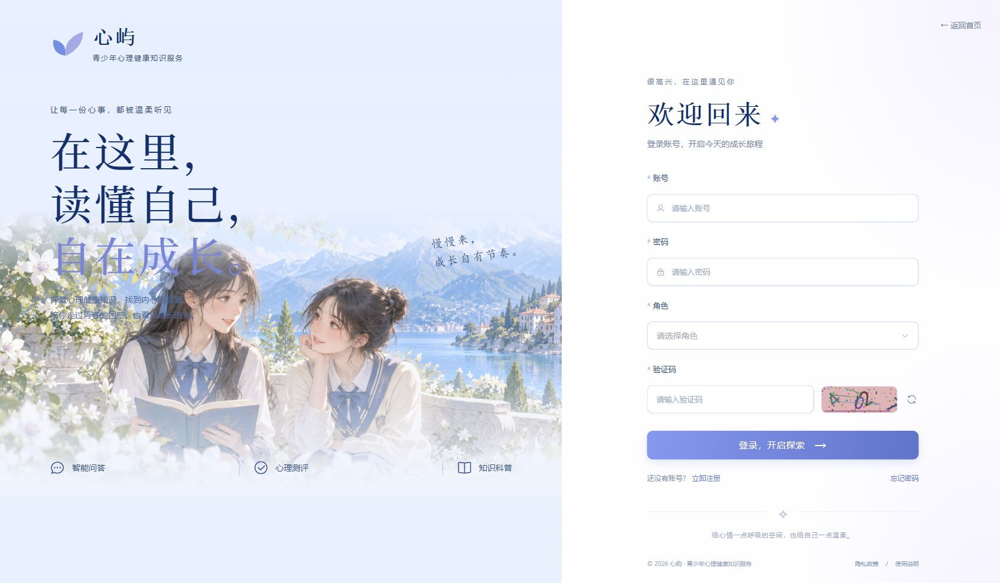

图 2-3  用户登录界面

### 2.6 心理测评页面

心理自评功能包括量表选择、在线作答、结果查看和历史记录查询。用户完成作答后，服务端根据量表的评分规则计算得分，并返回相应的结果说明。用户可以在个人记录中回看历次测评结果。


图 2-4  已上线网站的心理测评页面：量表选择与作答入口

### 2.7 科普阅读页面

科普专区按主题组织心理健康文章，支持分类浏览、全文阅读和文章收藏，方便用户查找知识并保存感兴趣的内容。系统结合用户的收藏、评论等互动情况，以及文章类别与热度推荐相关文章，为用户提供进一步的阅读参考。


图 2-5  已上线网站的科普阅读页面：分类、搜索与文章入口

## 三、系统架构与工程设计

### 3.1 总体架构与前端组织

系统采用前后端分离架构，由 Web 前端、业务服务、数据存储和外部模型服务组成。前端负责页面展示、用户输入和交互反馈，通过 HTTP 接口完成普通业务请求，通过 SSE 接收问答内容。后端负责身份验证、业务处理、知识检索和模型调用，并统一访问数据库及文件资源。

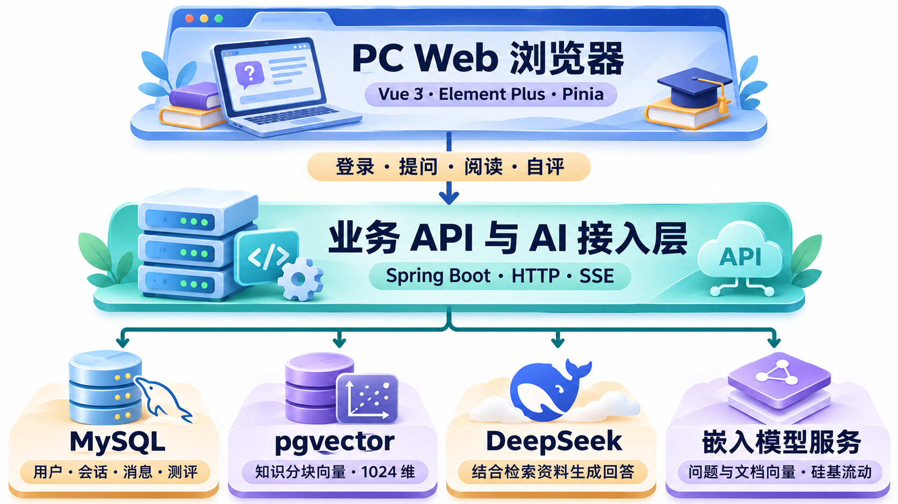

图 3-1  系统总体架构

后端采用分层单体结构，将相关业务集中在同一应用中部署。各模块通过明确的职责划分协作，便于开发调试和日常维护。

| 技术层次 | 主要技术 | 主要用途 |
| --- | --- | --- |
| 页面构建 | Vue 3、Vite、Element Plus | 构建页面、表单和交互组件。 |
| 状态与导航 | Pinia、Vue Router | 管理共享状态和页面切换。 |
| 接口请求 | Axios、fetch | 处理普通请求和流式数据接收。 |
| 业务服务 | Java 17、Spring Boot 3.3.1 | 实现登录、业务处理和模型接入。 |
| 数据访问 | MyBatis-Plus、MySQL | 查询和保存结构化业务数据。 |
| 知识处理 | LangChain4j、pgvector | 完成文本分块、向量存储与检索。 |

前端采用 Vue 单文件组件，以 JavaScript 编写页面逻辑，将模板、交互和样式组织在相应组件中。工程按照用户端页面、后台页面、公共组件、路由状态和通用工具划分模块。

| 前端模块 | 主要内容 |
| --- | --- |
| 用户端页面 | 首页、智能问答、科普阅读、心理自评和个人记录。 |
| 后台管理页面 | 用户、文章、知识文档、量表及评分规则管理。 |
| 公共组件 | 可复用的页面结构和视图组件。 |
| 路由与状态管理 | 页面导航、登录状态和共享数据。 |
| 公共工具 | 接口请求、流式解析和通用处理方法。 |

普通接口通过公共请求工具调用。问答接口使用 fetch 读取响应流，再由独立解析器处理数据帧，使流式解析与页面展示分别维护。

### 3.2 服务端分层设计

| 层次 | 职责 |
| --- | --- |
| Controller | 接收 HTTP 请求，调用业务服务并返回结果。 |
| Service | 执行业务规则、模型调用、知识检索和事务处理。 |
| Mapper | 完成数据库查询与数据写入。 |
| Entity / DTO | 表达业务实体，组织接口请求和响应数据。 |
| 权限拦截器 | 校验登录状态和操作权限。 |
| 公共工具 | 提供文件解析、访问控制等通用能力。 |

权限拦截器负责判断请求是否允许访问，业务层进一步检查记录归属和操作条件。例如，查询会话时核对用户身份，提交测评时校验题目、选项和评分规则。

### 3.3 依赖管理与环境配置

前端使用依赖声明文件和锁定文件管理安装版本，后端通过 Maven 管理 Java 依赖。数据库连接、JWT 密钥及模型凭据通过后端环境变量或本地配置加载，仓库提供无真实密钥的模板。项目保留 Git 历史，以 feat、fix、docs 等类型说明功能开发、问题修复和文档调整，方便协作与追踪。

### 3.4 数据模型与存储设计

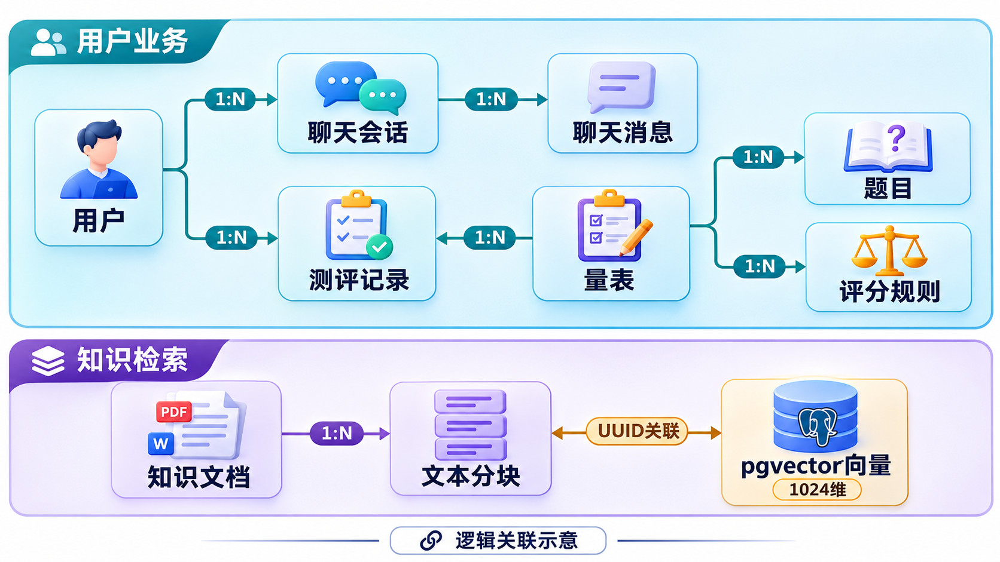

图 3-2  核心数据实体逻辑关系

系统按照用户业务和知识检索两类需求组织数据。用户可以创建多个会话，每个会话保存相应的用户问题和 AI 回复。测评记录关联用户与量表，并保留提交时的答案和计算结果。知识文档拆分为多个文本分块，分块记录通过向量 UUID 与 pgvector 中的数据建立关联。

MySQL 保存用户、会话、消息、文章、量表、测评记录和知识分块等数据；PostgreSQL 与 pgvector 保存文本向量并提供相似度检索；文档原文件及图片等资源保存在本地资源目录中。

检索获得向量候选后，后端根据 UUID 查询对应的知识分块，检查关联是否有效，再将分块原文用于回答生成。AI 消息同时保存关联分块 ID 和接口返回的 Token 用量，便于维护时核对参考资料及调用情况。

### 3.5 数据初始化与索引建立

项目初始化 SQL 提供 11 篇知识文档和 44 个文本分块，用于新环境建立基础演示内容。向量数据需要在部署环境中调用嵌入服务生成，并与业务分块建立关联。新库初始化后，管理员应建立知识向量，再通过索引检查确认分块、原文和向量的对应关系。系统运行过程中新增或更新资料会改变数据数量，日常维护以实际查询和检查结果为准。

## 四、AI 技术方案与知识检索

### 4.1 模型选型与接入方式

系统将回答生成与文本向量化分别交由两类模型处理。DeepSeek 负责理解问题、结合上下文组织回答；嵌入模型负责将文档和问题转换为向量，使系统能够比较文本之间的语义相关性。两者共同完成知识检索与回答生成流程。

| 能力 | 当前配置 | 选型考虑 |
| --- | --- | --- |
| 回答生成 | DeepSeek API<br>deepseek-flash | 支持中文交流、多轮问答和流式输出。 |
| 文本嵌入 | 硅基流动 API<br>BAAI/bge-large-zh-v1.5 | 将文档和问题转换为统一的 1024 维向量。 |
| 向量存储 | PostgreSQL + pgvector | 保存向量并支持相似度检索，通过 UUID 关联业务分块。 |

模型调用统一由后端封装，DeepSeek 与嵌入服务分别配置访问凭据。浏览器通过业务接口提交问题，由后端完成检索和模型请求。

### 4.2 生成参数与接口处理

| 参数 | 当前值 | 设计用途 |
| --- | --- | --- |
| temperature | 0.3 | 降低输出随机性，使回答表达相对稳定。 |
| max_tokens | 2000 | 控制单次回答的生成上限。 |
| 连接超时 | 15 秒 | 限制建立模型服务连接的等待时间。 |
| 读取超时 | 120 秒 | 限制等待上游响应数据的时间。 |
| 用户问题长度 | 最多 2000 字 | 控制输入规模，过滤空白和过长问题。 |

模型接入层统一处理凭据错误、余额不足、限流及服务异常，并向前端返回便于理解的提示。接收结果时，系统检查回答是否为空、结束原因是否正常，以及响应流是否完整结束，为后续保存提供判断依据。

### 4.3 文档解析、分块与索引更新

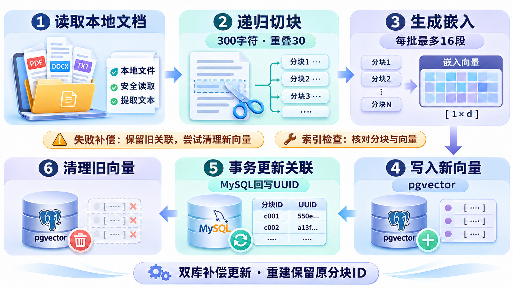

图 4-1  知识文档处理与索引更新流程

管理员提供知识文档后，后端使用 Apache Tika 提取本地原文件中的文本，再按照递归策略进行分块。当前分块上限为 300 个字符，相邻分块保留 30 个字符的重叠，用于保留部分上下文联系。系统每批最多向嵌入服务提交 16 个分块，生成对应向量，并记录文档和分块位置。

文档更新需要协调 MySQL 中的业务记录和 PostgreSQL 中的向量数据。系统先生成并写入新向量，再通过 MySQL 事务更新分块关联，成功后清理旧向量。

如果更新中途失败，系统会尝试清理本次新增的向量，并保留原有关联。由于两类数据库分别执行操作，更新流程还需要配合索引检查处理可能遗留的异常数据。重建已有分块向量时保留分块 ID，以维持历史消息与知识资料的关联。

### 4.4 索引维护与资料管理

索引检查围绕分块 UUID、实际向量记录、原文内容、向量维度和孤立数据进行比对，并列出待处理文档，帮助管理员定位缺失或失效的关联。资料维护同时包括技术检查与内容审核：前者确认资料能够被正确检索，后者关注出处、完整性和适用范围。管理员应结合索引结果、待处理清单和原文内容开展维护。

### 4.5 向量检索与关键词降级

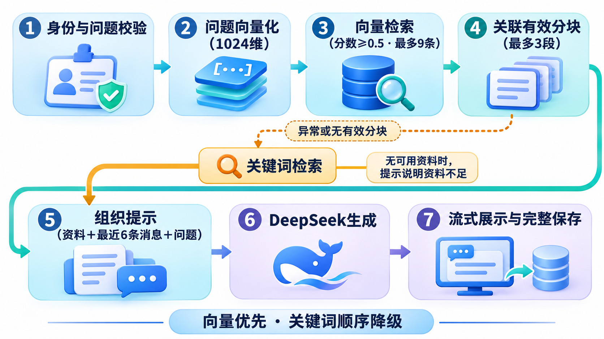

图 4-2  检索增强问答流程

用户问题通过校验后，系统使用与文档一致的嵌入模型生成问题向量，再执行相似度检索。当前流程以匹配分数 0.5 为筛选参数，先获取最多 9 个候选结果。后端按照返回顺序查询对应的业务分块，过滤失效关联，最终选取最多 3 段资料加入生成提示。

当向量服务暂时不可用，或没有获得有效分块时，系统转为关键词检索。关键词来自预置主题词，或从问题中清洗得到的最多 6 个词项，通过 MySQL LIKE 查询寻找相关内容。

| 状态 | 含义 |
| --- | --- |
| vector | 通过向量检索获得有效资料。 |
| keyword | 通过关键词降级检索获得资料。 |
| none | 本次未获得可用的知识分块。 |

检索状态有助于维护人员判断实际使用的处理路径，并分析未命中或服务异常的原因。

### 4.6 检索参数的设计考虑

检索先获取较多候选，为过滤失效关联保留选择空间；最终选取 3 段，以控制模型输入长度。相邻分块的重叠部分用于补充上下文，减少语义割裂。

这些参数属于当前工程配置。后续可结合带参考答案的测试问题，检查检索相关性和回答质量，再调整分块大小、匹配阈值和候选数量。没有检索到相关资料时，系统在提示中说明资料不足，并要求模型采用谨慎表达。实际回答仍需通过问题样本进行检查和评估。

### 4.7 提示组织与回答要求

一次问答请求由系统要求、检索资料、最近消息和当前问题共同组成。

| 顺序 | 输入内容 | 主要作用 |
| --- | --- | --- |
| 1 | 系统场景与回答要求 | 明确知识服务定位、表达方式和使用边界。 |
| 2 | 本次检索获得的知识分块 | 提供与问题相关的参考资料。 |
| 3 | 数据库中最近 6 条消息 | 按时间顺序补充交流背景。 |
| 4 | 当前用户问题 | 明确本轮需要回应的内容。 |

系统将知识分块作为参考资料处理。对于资料中可能出现的角色切换、泄露信息或覆盖系统规则等指令，提示要求模型忽略，避免文档内容干扰正常问答。回答要求强调使用容易理解的语言，结合已有资料回应问题，并保持心理健康知识服务的适用边界。

### 4.8 多轮问答流程示例

以“最近学习压力很大，我可以怎么调整？”为例，系统首先验证用户身份及会话归属，再将问题转换为向量，检索与学习压力和支持环境等主题相关的知识分块。获得资料后，系统加入最近的会话消息和当前问题，调用 DeepSeek 组织回答，并通过流式传输展示生成内容。回答完整生成并保存后，成为当前会话的一部分。

用户继续追问时，最近 6 条消息为模型提供交流背景，使回答能够联系前文。更早的记录仍保存在数据库中，供用户查询和回看。该示例用于说明处理流程。

### 4.9 回答展示与知识参考管理

对话区集中展示用户问题与 AI 回复，保持阅读的连续性。后端保留回答与知识分块的关联信息，供维护时核对参考资料；管理员可在知识文档详情中查阅原文及已标注的出处。知识维护需要结合实际问题持续检查，除确认分块与向量对应，还应审核原文、补充可核对的出处，并检查模型是否正确理解和使用资料。

## 五、核心功能实现

### 5.1 流式问答与记录保存

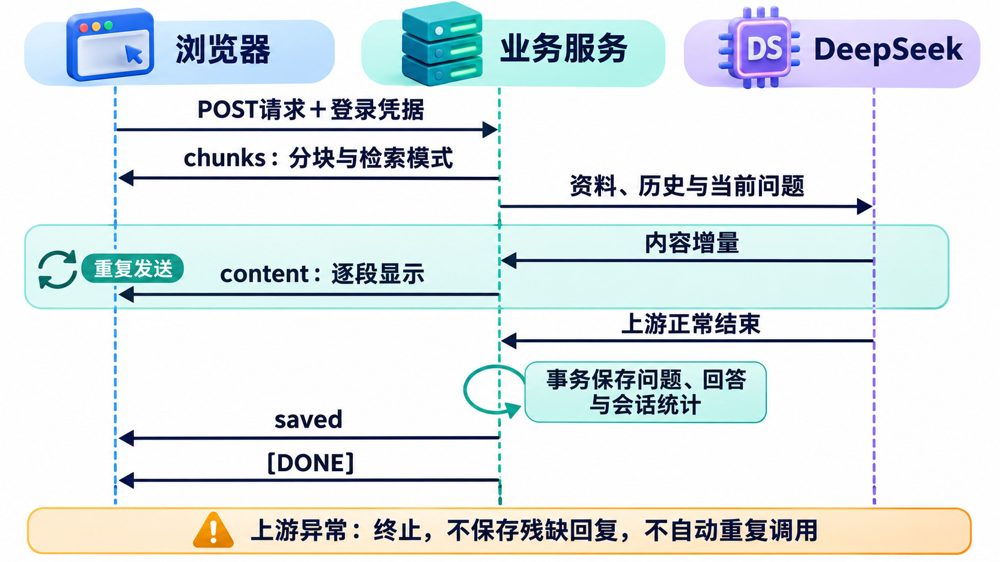

图 5-1  流式问答与记录保存时序

问答采用 SSE 流式交互。浏览器通过带登录凭据的 POST 请求提交问题，后端检查会话归属和输入内容，完成检索后调用 DeepSeek。模型生成文本时，后端持续发送内容事件，前端接收后更新页面，使用户能够逐步阅读回答。

回答正常结束后，系统在同一个 MySQL 事务中保存用户问题、AI 回复和会话统计。保存成功后，后端依次发送 saved 事件和 [DONE] 结束标志，前端据此确认本次问答已经完成。

| 情形 | 处理方式 |
| --- | --- |
| 中文字符或 JSON 数据跨网络包 | 使用流式 TextDecoder 和帧缓冲拼接数据，完整解析后再处理。 |
| 上游报错或缺少结束标志 | 终止本次流程并提示错误，残缺回答不作为正常记录保存。 |
| 用户离开问答页面 | 取消浏览器当前请求，之后可通过历史查询核对保存结果。 |
| 同一会话重复发送请求 | 通过后端实例内的会话运行集合限制重复生成。 |

流式请求失败后，系统不会自动追加一次非流式模型调用，避免产生重复请求。发生网络中断时，已保存的历史记录作为最终查询依据。

### 5.2 身份认证与访问控制

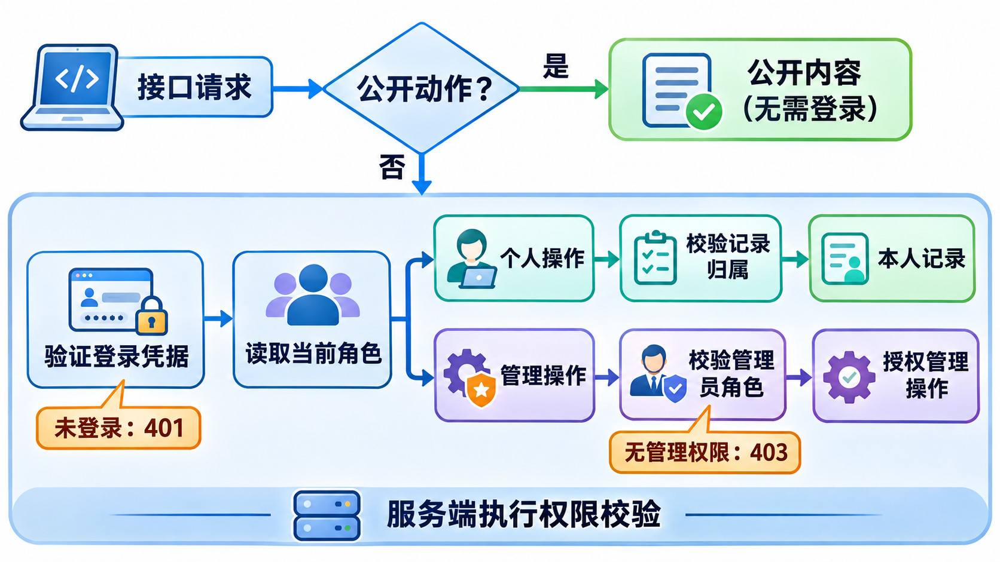

图 5-2  访问控制流程

系统使用 JWT 传递登录凭据，当前有效期为 8 小时。处理请求时，后端验证凭据，并读取账号当前角色及密码凭据状态，使权限调整和密码修改能够影响后续访问。

接口按照公开、个人和管理操作划分。公开接口由白名单明确列出；个人操作要求登录；管理操作要求管理员权限。访问具体记录时，业务层继续检查记录是否属于当前用户。

| 身份或操作 | 服务端规则 |
| --- | --- |
| 游客访问公开内容 | 按公开白名单放行。 |
| 未登录访问个人功能 | 拒绝请求，返回 401。 |
| 普通用户使用个人功能 | 校验登录状态和记录归属。 |
| 普通用户访问管理功能 | 拒绝请求，返回 403。 |
| 管理员执行管理操作 | 根据当前角色授权，并检查业务条件。 |
| 用户公开注册 | 统一创建普通用户账号。 |

前端菜单和路由组织操作入口，最终访问权限由服务端确定。

### 5.3 密码、密钥与文件安全

新密码使用 BCrypt 哈希保存。旧 MD5 格式账号在密码验证通过并成功登录后升级存储格式。缺少身份核验的在线找回密码入口已关闭。

数据库密码、JWT 签名密钥和模型 API Key 通过后端环境变量或被 Git 忽略的本地配置加载，避免随公开仓库和前端构建文件发布。文件上传检查扩展名、文件名和批次数量，每批允许上传 1-10 个文件，并使用 UUID 目录组织资源。知识文档解析时，系统检查规范化路径和真实文件位置，确保解析范围位于指定上传目录内。

### 5.4 心理自评计分与结果保存

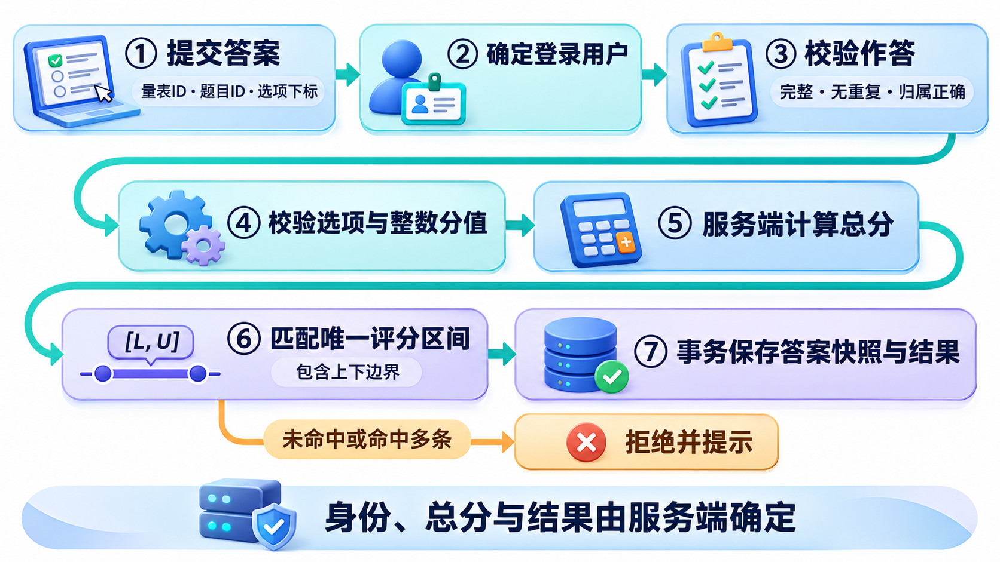

图 5-3  心理自评提交与计分流程

心理自评由前端提交量表 ID、题目 ID 和选项下标。用户身份从登录状态获取，题目分值和评分规则由服务端读取。提交后，系统依次检查作答是否完整、题目是否重复、题目是否属于当前量表，以及选项是否在合法范围内。通过校验后，根据所选选项的整数分值计算总分。

| 检查项目 | 主要内容 |
| --- | --- |
| 作答完整性 | 检查漏答、重复题目和题目数量。 |
| 题目归属 | 检查提交题目是否属于当前量表。 |
| 选项合法性 | 检查选项下标和分值配置。 |
| 评分规则 | 要求当前总分恰好命中一条评分区间。 |
| 结果保存 | 保存答案快照、总分、结果说明和服务端时间。 |

评分区间包含上下边界。当前总分未命中规则，或同时命中多条规则时，系统拒绝生成结果并提示处理。校验通过后，系统在事务中保存测评记录，以及题目 ID、选项下标、选中标签和当时分值等答案快照，便于回看与核对。

## 六、创新点与应用价值

### 6.1 面向青少年场景的应用创新

心屿围绕学习压力、情绪调节和人际沟通等日常话题，将智能问答、科普阅读与心理自评整合到同一 Web 平台。用户可以从问题交流开始，也可以自主阅读知识或选择量表，再通过个人记录查看会话、收藏与测评结果。统一入口和持续记录，使不同功能能够围绕同一用户的知识需求展开。

### 6.2 围绕业务流程的技术特色

| 方向 | 实现方式 | 应用价值 |
| --- | --- | --- |
| 知识增强问答 | 将知识分块、检索结果和最近会话加入模型提示。 | 为回答提供项目资料和交流背景。 |
| 可靠流式交互 | 分别处理内容展示、事务保存和完成确认。 | 兼顾及时反馈与记录完整性。 |
| 索引维护 | 支持关联检查、向量重建和更新失败补偿。 | 帮助定位和处理知识更新后的索引问题。 |
| 服务端业务校验 | 统一执行权限、记录归属和测评计分检查。 | 减少客户端修改对关键结果的影响。 |

项目的技术特色主要体现在模型能力与网页业务的整合，以及各环节之间的数据一致性和异常处理。

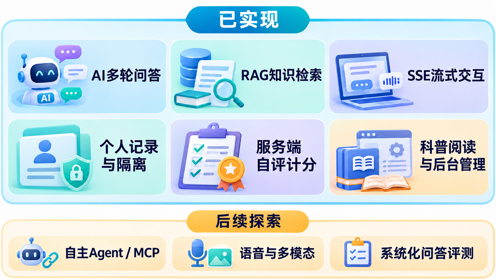

图 6-1  平台主要能力与后续拓展方向

### 6.3 应用价值

平台可用于校园心理健康知识宣传和个人自主学习，为用户提供集中的知识获取入口。后台维护功能使文章、知识文档和量表能够持续更新，个人记录则支持用户回顾已有交流与学习内容。后续可结合实际使用反馈，评估页面易用性、知识覆盖和回答质量，逐步改进服务。

## 七、测试与验证

### 7.1 测试方法

项目通过自动化测试检查核心业务与异常处理。后端测试由 Maven 执行，前端测试使用 Node.js 测试器。测试采用模拟对象、回环假模型服务和临时文件，主要验证业务规则、流式解析和异常处理。测试过程未连接真实数据库，也未调用付费模型接口。

### 7.2 自动化测试结果

| 测试组 | 数量 | 主要验证内容 | 结果 |
| --- | --- | --- | --- |
| 账号与演示初始化 | 12 | 注册权限、密码升级、演示账号维护。 | 通过 |
| 接口权限与记录归属 | 12 | 管理访问限制、他人记录访问限制。 | 通过 |
| 测评提交 | 11 | 服务端计分、伪造字段、漏答和规则冲突。 | 通过 |
| 模型客户端与聊天失败 | 8 | 内容接收、接口错误、截断和失败保存控制。 | 通过 |
| 文件与本地解析 | 6 | 上传限制、路径穿越和解析范围。 | 通过 |
| 索引与出处处理 | 7 | 重建顺序、失败补偿、关联保留和来源解析。 | 通过 |
| 文章排序 | 10 | 排序和相关数据查询。 | 通过 |
| 前端 SSE 解析 | 4 | 中文与 JSON 跨包、截断和权限错误。 | 通过 |

后端 66 项测试通过，失败、错误和跳过均为 0；前端 SSE 解析 4 项通过，共计 70 项。这些结果验证了现有用例覆盖的业务规则与异常路径。平台已正式上线，线上运行维护结合真实接口检查与用户操作验收持续开展。

### 7.3 真实接口集成记录

项目通过真实接口集成验证模型调用、代理转发、历史记录恢复和权限隔离，并保留相关验收记录。

| 历史验收场景 | 记录结果 |
| --- | --- |
| 真实流式问答 | 接口返回用量 717 Token。 |
| 真实非流式问答 | 接口返回用量 670 Token。 |
| 本机 Nginx 转发 | 向量检索命中 3 个分块，真实流式调用用量 578 Token。 |
| 会话持久化与隔离 | 已保存记录可以恢复，他人记录访问被拒绝。 |
| 新库初始化验证 | 初始化数据包含 44 个分块，其中文档 ID 4 对应 4 个分块。 |

上述记录反映当时环境中的接口连通和业务执行情况。Token 用量用于核对模型调用，不作为准确率或性能指标。目前尚未建立带参考答案的系统化问答评测，也未形成可重复的平均延迟、P95 和并发容量测试结果。后续应分别开展回答质量与运行性能评测。

### 7.4 正式演示验收

| 验收项目 | 检查内容 |
| --- | --- |
| 登录与权限 | 验证普通用户和管理员的访问范围。 |
| 模型调用 | 提交真实问题，核对回答、用量和异常提示。 |
| 知识检索 | 检查检索模式、相关分块和原文对应关系。 |
| 历史记录 | 刷新、重新登录后查询已保存的会话。 |
| 数据隔离 | 使用不同普通账号交叉验证个人记录访问。 |
| 心理自评 | 完成作答，核对计算结果和历史记录。 |
| 部署链路 | 在正式网站检查页面、接口和流式传输。 |

## 八、安装运行与部署方案

平台已正式上线，评审可直接在浏览器访问：https://xinyu-care.xyz/#/front/home。以下环境与启动说明用于本地复现和服务器维护。

### 8.1 运行环境

| 环境 | 要求 |
| --- | --- |
| 浏览器 | 支持现代 Web 标准的桌面浏览器。 |
| 前端环境 | Node.js 18 及以上版本、npm。 |
| 后端环境 | JDK 17、Maven 3.9.x。 |
| 业务数据库 | MySQL 8.x。 |
| 向量数据库 | PostgreSQL，安装并启用匹配版本的 pgvector。 |
| 模型服务 | 有效的 DeepSeek 和嵌入服务凭据。 |
| 生产入口 | Nginx。 |

本地前端页面端口为 8000，后端接口端口为 7406。

### 8.2 环境配置与数据准备

在项目根目录的 CMD 中执行：

```cmd
if not exist .env.properties copy .env.example .env.properties
notepad .env.properties
```

根据实际环境填写数据库连接、JWT 密钥和模型服务参数。

| 配置项 | 用途 |
| --- | --- |
| MYSQL_USERNAME、MYSQL_PASSWORD | MySQL 访问凭据。 |
| PGVECTOR_USER、PGVECTOR_PASSWORD | PostgreSQL 访问凭据。 |
| JWT_SECRET | 登录凭据签名密钥。 |
| DEEPSEEK_API_KEY | 回答生成服务凭据。 |
| EMBEDDING_API_KEY | 文本嵌入服务凭据。 |

首次运行时，应建立独立的演示数据库，按照仓库说明导入 MySQL 初始化文件，并在 PostgreSQL 中启用 vector 扩展。初始化 SQL 包含重建表操作，仅用于新库准备。数据库配置完成后，管理员建立知识向量，再检查分块与向量的对应关系。

### 8.3 本地启动

在第一个 CMD 窗口中，从项目根目录进入后端目录，下载依赖并启动演示模式：

```cmd
cd QaMentalHealthKnowledgeServicesAdolescents.springboot
mvn.cmd dependency:go-offline "-Dmaven.repo.local=.maven-repository"
mvn.cmd spring-boot:run "-Dmaven.repo.local=.maven-repository" "-Dspring-boot.run.profiles=demo"
```

在第二个 CMD 窗口中，从项目根目录进入前端目录：

```cmd
cd QaMentalHealthKnowledgeServicesAdolescents.elementui
npm.cmd ci --cache .npm-cache
npm.cmd run dev
```

保持数据库服务和两个 CMD 窗口运行，在浏览器中打开 http://localhost:8000。演示模式提供以下固定测试账号：

| 账号 | 密码 | 角色 |
| --- | --- | --- |
| user | 12345678 | 普通用户 |
| admin | 12345678 | 管理员 |

演示模式维护账号和角色，并保留关联业务记录。生产环境使用独立的正式账号配置。

### 8.4 构建与生产部署

在前端目录执行构建命令：

```cmd
npm.cmd run build
```

在后端目录执行打包命令：

```cmd
mvn.cmd package "-Dmaven.repo.local=.maven-repository"
```

前端生成静态页面文件，后端生成 JAR 包。项目提供发布整理脚本和 Nginx 配置模板，用于准备生产运行文件。

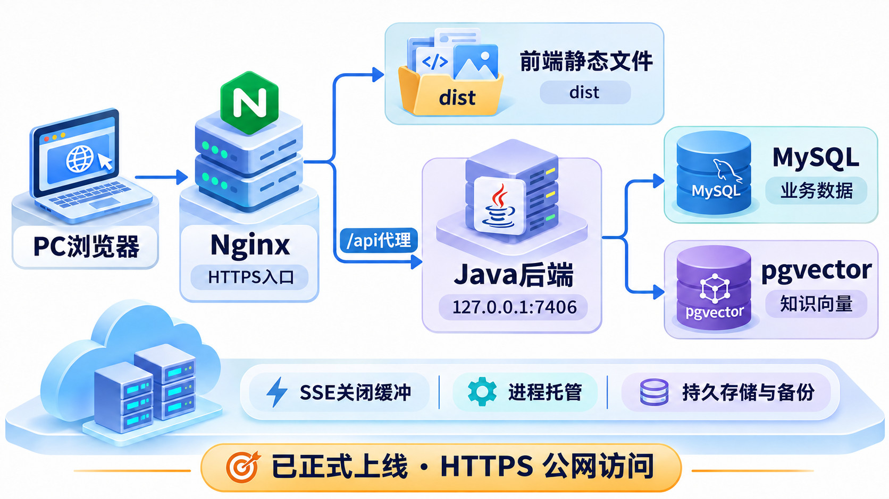

图 8-1  生产部署架构

生产环境由 Nginx 托管前端页面，通过同站 /api 路径转发后端请求。后端默认监听 127.0.0.1:7406，数据库保持内网访问。流式接口关闭代理缓冲，并配置适当的读取超时。

平台已通过正式域名提供 HTTPS 访问。日常运维围绕服务进程、持久化数据、备份恢复及关键业务检查开展，保持网站稳定运行。

项目已正式上线，访问地址为：https://xinyu-care.xyz/#/front/home。网站由服务器持续运行，开发电脑关闭后仍可通过公网访问。

## 九、项目总结与团队分工

### 9.1 项目总结

心屿以 Web 页面为载体，完成了智能问答、科普阅读、心理自评和后台维护等功能，为青少年心理健康知识学习提供统一入口。

AI 问答流程覆盖文档解析、文本分块、向量生成、知识检索、多轮提示、流式输出和记录保存。服务端统一处理访问权限、个人记录归属和测评计分，使关键业务具有明确的执行规则。现有验证包括 70 项自动化测试和既有真实接口验收记录。平台已完成公网部署，后续工作将围绕知识质量、回答评测和线上运行维护展开，进一步完善平台的使用体验和维护能力。

### 9.2 团队信息与成员分工

| 项目 | 内容 |
| --- | --- |
| 学校 | 华南师范大学 |
| 团队名称 | 不知名队伍- |
| 指导教师 | 刘寿强 |
| 队长 / 队员 | 黄彪骐 / 蓝俊豪、林佳逸 |

| 成员 | 主要职责 |
| --- | --- |
| 黄彪骐 | 负责整体技术架构与模块划分，设计并实现后端业务逻辑，协调关键流程开发与系统集成。 |
| 蓝俊豪 | 负责素材收集、筛选与整理，以及配套图片创作，为页面视觉和内容展示提供支持。 |
| 林佳逸 | 负责前端页面与交互设计，开展功能和页面效果测试，承担部署准备与上线实施工作。 |

### 9.3 后续工作

后续优先完善知识与回答评测，审核原文和出处，建立具有参考答案的测试问题；维护已上线的网站，持续检查 HTTPS、进程状态、持久存储和备份恢复；开展正式演示验收，检查问答、模型用量、历史恢复、权限隔离和心理自评，并修复发现的问题。

自主 Agent、MCP 工具和语音多模态可作为后续拓展方向，具体功能根据实际需求和验证结果逐步推进。

## 参考资料与复核说明

### 1. 赛事与项目资料

[1] 传智杯 AI WEB 网页开发挑战赛官方页面。
https://www.boxuegu.com/matchTrack/detail/?id=10037

[2] 心屿项目公开代码仓库。
https://github.com/hahahachaoge/xinyu

正式网站：https://xinyu-care.xyz/#/front/home。心理测评与科普阅读截图采集自已上线的网站。

[3] 项目环境配置、评审运行、知识维护和生产部署说明。

[4] 项目自动化测试记录与真实接口集成验收记录。

### 2. 关键实现定位

| 实现内容 | 主要类或模块 |
| --- | --- |
| 问答流程与多轮上下文 | AiChatServiceImpl |
| DeepSeek 接口处理 | DeepSeekClient |
| 文档分块与向量更新 | VectorServiceImpl |
| 索引检查 | VectorIndexAudit |
| 登录与接口权限 | CurrentUserInterceptor |
| 心理自评计分 | AssessmentSubmissionService |
| 前端聊天交互 | AiChat 页面 |
| 流式数据解析 | SSE 解析工具及对应测试 |

### 3. 测试复核命令

在后端目录执行：

```cmd
mvn.cmd test "-Dmaven.repo.local=.maven-repository"
```

在前端目录执行：

```cmd
node --test src/utils/sse.test.js
npm.cmd run build
```

### 作品发表、获奖与开发说明

本项目此前未发表、未获奖，非基于其他项目进行优化或改进。团队围绕青少年心理健康知识服务需求，完成系统架构、业务逻辑、前端页面、视觉素材和部署相关工作。

项目使用 Vue、Spring Boot、LangChain4j、pgvector 等通用开源技术，接入 DeepSeek 与嵌入模型服务。上述框架和模型不属于团队自研成果；相关依赖、素材和第三方服务按其许可及使用条件使用。
